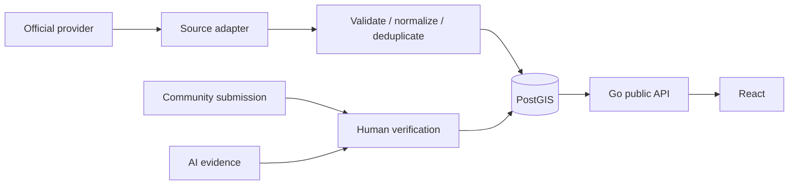

# Data flow (future phases)

These flows are **not running in Phase 0**. A future worker owns external fetches and records observation time separately from receipt time; provider adapters prevent vendor models entering domain code. Every published observation should carry source, source type, freshness, verification status, and confidence where applicable. A network failure or stale observation must produce an explicit unknown/unavailable state, never a reassuring default.
