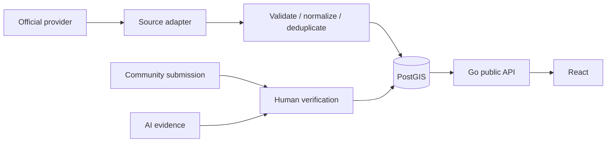

# Data flow (Phase 2 canonical store)

The PostGIS tables, domain service, and public read API now exist, but the upstream adapter/review/worker flows in this diagram are **not running in Phase 2**. A future worker owns external fetches and records observation time separately from receipt time; provider adapters must prevent vendor models entering domain code. API reads join canonical source identity and derive freshness centrally. No data is seeded or represented as live. A network failure or stale observation must produce an explicit unknown/unavailable state, never a reassuring default. See `flood-domain.md`.
