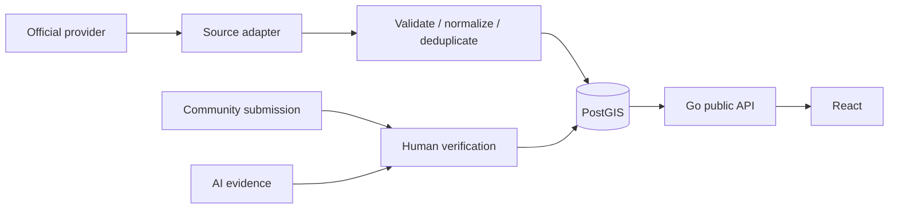

# Data flow (Phase 3 ingestion boundary)

The PostGIS tables, domain service, and public read API remain in place. The Go worker now provides the fetch/validate/normalize/deduplicate/persist boundary for water observations, but **no live external adapter is registered**; only an opt-in synthetic fixture exists for tests/development. Community/AI review flows in this diagram are future scope. The worker retains upstream observation time separately from receipt time, and provider models do not enter domain code. API reads join canonical source identity and derive freshness centrally. A network failure or stale observation produces unknown/unavailable evidence, never a reassuring default. See `flood-domain.md` and `ingestion.md`.
