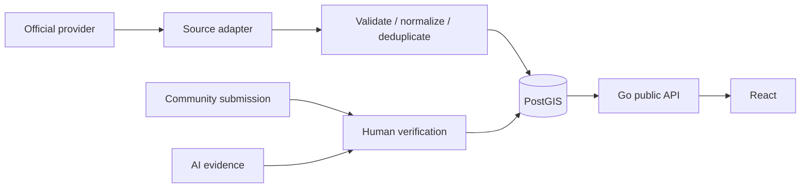

# Data flow (Phase 3 ingestion boundary)

The PostGIS tables, domain service, and public read API remain in place. The Go worker provides the fetch/validate/normalize/deduplicate/persist boundary for water observations, but **no live external adapter is registered**; only an opt-in synthetic fixture exists for tests/development. Community reports have a separate human moderation flow. Private-media AI jobs can produce unverified evidence only from a configured, non-mock model and require ADMIN review before canonical observations are published. No real model is bundled. The worker retains source report/provider time separately from receipt time. API reads join canonical source identity and derive freshness centrally. A dependency failure or stale observation produces unknown/unavailable evidence, never a reassuring default. See `flood-domain.md`, `ingestion.md`, and `ai-boundary.md`.
