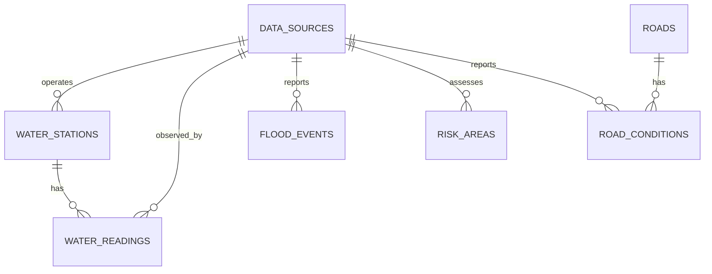

# Phase 2 flood domain

The Phase 2 database and public read API began as a canonical **empty** domain, not a live situation feed. Phase 3 adds an opt-in synthetic-only ingestion worker but no live external provider, production seed, map UI, alert engine, routing engine, or claim that a road is safe. Synthetic geometries in integration tests are removed after each test and are not Ongkharak observations. See `ingestion.md` for the worker boundary.

`DataSource` is the canonical provenance record (`OFFICIAL`, `COMMUNITY`, `AI`); observations reference it rather than copying or promoting source type. Its `provider` is a display identifier, not a credential store. `WaterStation` is a point owned by a source; readings can reference another source. `WaterReading` stores nullable water level in **meters**, flow in m³/s, and rainfall in mm; at least one measurement must exist. Station/source/observed time is unique. `FloodEvent` stores a source-aware point/polygon/multipolygon with `INFO`, `WATCH`, `WARNING`, `CRITICAL`, or `UNKNOWN` severity and `ACTIVE`, `RESOLVED`, or `UNKNOWN` status. `RiskArea` stores a multipolygon with `LOW`, `MODERATE`, `HIGH`, `VERY_HIGH`, or `UNKNOWN` risk. `Road` is a physical multiline geometry; `RoadCondition` is time/source-specific evidence with `PASSABLE`, `WATCH`, `SMALL_VEHICLE_NOT_RECOMMENDED`, `CLOSED`, or `UNKNOWN`. All three observation families that support review retain `UNVERIFIED`, `VERIFIED`, or `REJECTED`, and nullable 0–1 confidence. None of these statuses are UI colors.

PostGIS is the geometry source of truth, SRID **4326**. Station uses `Point`; event uses constrained `Point`, `Polygon`, or `MultiPolygon`; risk uses `MultiPolygon`; road uses `MultiLineString`. Polygon and line inputs are normalized to their multi equivalents. Coordinates in API GeoJSON are **longitude, latitude**. Database checks enforce geometry type, validity, nonempty extent, WGS84 bounds, and key timestamps. GiST indexes serve station, flood, risk, and road bounding-box intersections; B-tree indexes serve reading and condition history. A road/flood intersection is supported by `ST_Intersects`; no speculative routing or distance engine is exposed. List APIs are paginated (limit default 20, max 100; offset max 100000), with optional bbox on spatial collections. The map-specific composite endpoint is deferred; clients can request bounded spatial collections without fetching everything.

`observedAt` is the source observation time, `receivedAt` is the API/worker receipt time, and `createdAt` is persistence time. All are timezone-aware UTC internally; display localization belongs to the client. Source timestamps are not silently replaced by receipt time. `validFrom`/`validTo` govern risk assessment applicability; `validUntil` governs road evidence validity. Database uniqueness and foreign keys protect provenance and duplicate observations. Migration 4 adds finite-number checks for all nullable measurements and confidence fields so PostgreSQL `NaN` cannot escape as an invalid JSON response; existing non-finite records must be remediated before upgrading. API text limits count Unicode code points, not UTF-8 bytes.

`FreshnessPolicy` in the Go domain centrally defines current development thresholds: water 6 hours, flood event 24 hours, road condition 2 hours. Age up to the threshold is `FRESH`, up to twice the threshold `STALE`, older `EXPIRED`; missing or >5-minute future observations are `UNKNOWN`. Thresholds are policy defaults, not provider-specific scientific assurances; revisit them with source contracts in Phase 3. A stale/expired or not-VERIFIED road condition preserves `reportedStatus` but returns effective `status=UNKNOWN`; a road with no condition also returns UNKNOWN. Flood events preserve raw `severity`/`status` while `effectiveSeverity`/`effectiveStatus` become UNKNOWN when stale/expired or not VERIFIED. An undated or not-yet-valid risk assessment has `effectiveRiskLevel=UNKNOWN`; an ended one is EXPIRED. `UNKNOWN` must never be read as passable, safe, or absence of flooding. Filtering `status` on roads/conditions uses **reported** status; filtered results may have a different freshness-derived effective status.

GET source, water station, reading, event, risk, road, and road-condition routes are public, with a shared per-peer in-memory cap of 120 reads per minute. Only POST data sources, risk areas, and road conditions are available for ADMIN manual management; USER receives 403 and GUEST 401. A road must already exist to record a condition. Other entity writes are repository methods for deterministic tests/future internal pipelines, not public ingestion APIs. No user-supplied `sourceType` accompanies an observation; it is resolved from the referenced source. The per-process limiter is not a trusted edge limiter and can group users behind a proxy. Production requires request-level edge controls and source-specific freshness policy before live data is published.
