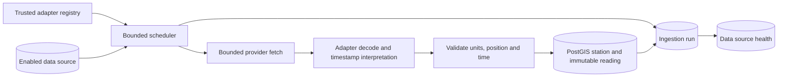

# Phase 3 ingestion boundary

Phase 7 adds a PostgreSQL trigger/outbox after persisted water readings. Duplicate source/station/observation timestamps still resolve at the existing ingestion uniqueness boundary; no external provider or official threshold is added. The worker evaluates new outbox evidence against explicitly configured alert rules independently of Redis delivery. See `realtime.md`.

The Go worker loads enabled `DataSource` rows, selects only exact source codes registered by server configuration, and runs a capability-specific `WaterObservationProvider`. `DataSource.provider` is display metadata, **not** an adapter selector or URL. No external live provider is registered in this phase. A synthetic fixture adapter is available only when explicitly configured in development/test; production rejects that configuration. The worker never creates a source automatically.

The enabled `AI_VISION_V1` source seeded by migration 000012 identifies internal AI evidence; it does not register a water-polling adapter. When unregistered and typed `AI`, the worker skips it with a debug diagnostic rather than a missing-adapter warning. Other unregistered codes, including other AI sources or this code with incorrect provenance, still warn. This does not disable the source, run AI inference, or mark it healthy; AI processing remains a separate capability.

`WaterSample` is provider-neutral adapter output, not a vendor payload. The fixture accepts only JSON with `kind: "SYNTHETIC_TEST_ONLY"` and an `observations` array of at most 1,000 records, each with a `SYNTH_*` station code, `Synthetic ` station name, coordinate strings, RFC3339 `observedAt` with offset, and nullable `{value, unit}` measurements. The fixture interprets RFC3339 offsets and converts to UTC; this is **not** a global Asia/Bangkok assumption. A malformed document or absent synthetic labeling fails the fetch; individual invalid observation times or measurements are rejected during normalization, allowing valid independent rows to proceed. Test geometries and values are not Ongkharak situation claims.

Water level accepts explicit `m` or `cm` (converted to meters); flow accepts `m3/s`, rainfall accepts `mm`. Unknown units, non-finite or out-of-`NUMERIC`-range numbers, missing measurements, impossible coordinates, future/missing timestamps, oversized text, and station fields containing control characters (including NUL) are rejected before SQL. `observedAt` remains upstream time; `receivedAt` is normalization/receipt time; the database records persistence time. The source ID and source type are derived solely from the configured `DataSource`, never a payload field. Inserted readings remain `UNVERIFIED` until a separately authorized review; no raw provider payload or secrets are stored.

Each run starts as `RUNNING` before networking. Valid independent observations are accepted while invalid rows count as rejected: all valid is `SUCCESS`, mixed is `PARTIAL`, and fetch failure or all invalid is `FAILED`. Persisting accepted station/readings, terminal counts, and source health occurs in one transaction. Station identity reconciles code and external ID within the source: a new external ID can attach to an existing code-only station, but two competing identities reject the ambiguous row while preserving independent rows. The reading uniqueness key `(station_id, source_id, observed_at)` makes repeated polls idempotent; duplicates count separately and existing readings are not overwritten. On a persistence failure, the engine retries terminalization as `PERSIST_FAILED` without observations; if PostgreSQL is unavailable for both attempts, the interrupted run remains visible until stale-run recovery. Provider failure leaves all prior readings intact. Freshness eventually derives `STALE`/`EXPIRED` and effective `UNKNOWN`, never SAFE.

Source health is independent of flood safety: it tracks the last attempt/success/failure, consecutive failures, and `HEALTHY`, `DEGRADED`, `UNAVAILABLE`, or `UNKNOWN`. Runs retain only bounded operational codes/summaries, counts, and timestamps—not credentials, response bodies, or upstream stacks. Logs include source ID/code, run ID, duration, counts, and status; they must not contain URLs with secrets, headers, or row payloads. An upstream outage does not fail API readiness.

The worker uses one ticker and a bounded two-run concurrency limit, with an in-process per-source guard and context cancellation. It waits for active runs on shutdown; Compose allows 30 seconds for cancellation and terminal persistence. This guard is not distributed multi-replica locking; operate one worker replica until a cross-replica lease is designed. Poll cadence is one minute for the opt-in fixture; no live provider polling interval is assumed. Unknown source codes are skipped with an explicit operational signal, never sent to a fallback adapter.

The reusable HTTP client has a ten-second per-attempt timeout, a 1 MiB response cap, three attempts, a fixed user agent, no redirects or proxy, and cancellable exponential backoff with jitter. Only transient transport errors and 429/502/503/504 are retried. A 429 `Retry-After` beyond the short retry budget fails instead of retrying early. Future live providers need their own verified contracts, rate limits, endpoints, credentials, units, timestamp rules, and source-specific intervals before registration. A configured live target must use HTTPS and deny private, loopback, link-local, and known special-use IP ranges at dial time after DNS resolution; no API accepts an arbitrary client-supplied fetch URL. The fixture may access private HTTP only under explicitly enabled development/test configuration. SSRF risk from operator-controlled environment configuration remains an operational trust boundary, not a public request capability.

Future provider integration: ThaiWater, DDPM, Google Flood Forecasting, and weather sources remain unimplemented pending verified API behavior, access terms, sample responses, units, identifiers, and timezone semantics. No Redis publishing, SSE, alerts, frontend ingestion UI, community submissions, CCTV, AI, or routing is part of Phase 3.
