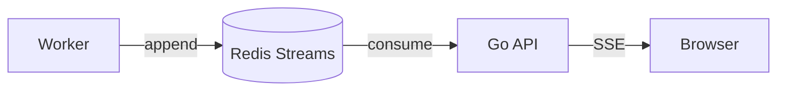

# Realtime boundary (future Phase 7)

Phase 0 establishes Redis connectivity only, not streams or SSE endpoints. Reserve semantic events: `water_level.updated`, `flood_event.created`, `flood_event.updated`, `road.status_changed`, `alert.created`, `report.created`, `report.verified`, and `cctv.status_changed`. Future delivery must define event IDs, replay/retention, reconnect with `Last-Event-ID`, heartbeat, backpressure, and authorization for nonpublic channels. Do not imply reliable delivery until these are implemented and tested.
