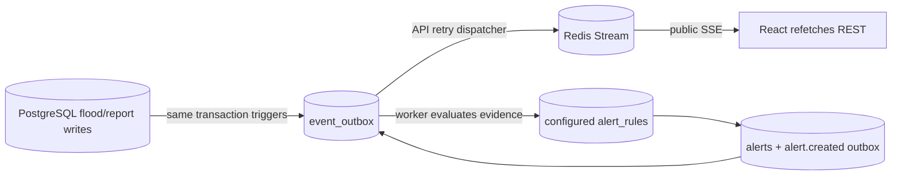

# Realtime and alerts (Phase 7)

Migration 8 refines road event delivery: transitions into and out of `UNKNOWN`, including unverified current conditions, notify clients to refetch instead of retaining an old passable state.
Migration 9 serializes concurrent condition inserts for the same road using a non-key row lock, preventing duplicate or missed status-change notifications while remaining compatible with foreign-key key-share locks.

Each API process caps public SSE subscriptions at 128 and replies 503 with Retry-After when full; ADMIN rule writes have per-account in-memory limits (10 creates and 30 updates per hour). These controls do not replace trusted edge limits for public traffic or shared quotas across replicas.

The public alert list bounds pagination to 50 items and 1,000 offset to avoid deep scans. A hostile guest can still exhaust the shared SSE slots; only a trusted edge with per-client connection/rate controls can mitigate starvation fairly without accepting spoofed forwarding headers.

PostgreSQL remains canonical. Migration 7 adds an outbox and AFTER triggers for inserted water readings, new flood events, changed current verified road conditions, and PENDING-to-VERIFIED community reports. Migration 21 additionally emits identifier-only `report.updated` for automatically published community submissions, edits/image revisions, removal and restoration. This is a canonical refetch signal, not factual verification; it contains no private moderation reason or removed content. `report.verified` remains the distinct reviewed-report signal. A committed write is never rolled back because Redis is unavailable. The API retries unpublished rows with `FOR UPDATE SKIP LOCKED`; delivery is **at least once**, because Redis may accept an event before the outbox commit fails. Event IDs are stable UUIDs across retries and clients dedupe them. Published outbox rows are pruned after seven days only once domain alert evaluation has completed. The outbox must be monitored and a trusted edge rate limiter is needed before public deployment.

The public Redis stream is `floodwatch:public:v1`, append-only with approximate 10,000-entry maximum retention. Public event envelopes include `eventId`, type, occurrence and publication times, source provenance, resource type/ID, `payloadVersion: 1`, and a small payload. They carry identifiers, not private report/user/media details or full canonical resources. Redis stream IDs are SSE cursors, not envelope event IDs. The public endpoint `/api/v1/events/stream` sends heartbeats, supports `Last-Event-ID` or a validated `cursor` query fallback, bounded replay of 100 entries, and `replay.reset` when the cursor is unavailable or history exceeds the replay limit. A reset requires a fresh REST read. Disconnects and slow writers are bounded; Redis outages affect the live channel, not REST reads.

The React app maintains one EventSource per app mount, reconnects with bounded exponential backoff, visibly distinguishes connected/reconnecting/disconnected, and refetches overview, map, reports, and alerts through canonical REST APIs on relevant events or a replay reset. Duplicate and malformed envelopes are ignored. Realtime transport never computes an alert or implies safety.

The worker independently evaluates only persisted evidence against explicitly configured structured rules. No rule or water threshold is seeded. Rule types are `WATER_LEVEL_THRESHOLD`, `ROAD_CLOSED`, and verified `FLOOD_CRITICAL`; unsupported statuses, including `UNKNOWN`, do not become `SAFE`. ADMIN-only POST/PUT rule endpoints reject unrecognized fields and do not accept source provenance. `alerts` records the evidence's `OFFICIAL`, `COMMUNITY`, or `AI` source and a unique `(rule_id, evidence_id)` decision; alert insertion and `alert.created` outbox insertion share a transaction. A failed evaluation leaves the domain outbox row unevaluated for retry. Public GET `/api/v1/alerts` omits evidence IDs and private review information; empty results do not mean safe. Rules are not retroactively evaluated against prior evidence, and stored alerts are decisions at trigger time, not continuously updated conditions. No notifications, CCTV/AI integration, route engine, or Phase 8 dashboard are included.
