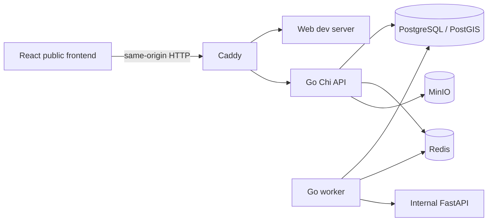

# System overview

The current public identity boundary is the Guest flow in `guest-public-flow.md`: no public login/signup entry, a browser-local editable display name, anonymous pending reports with scoped image uploads, and a public notifications feed. `/admin` redirects unauthenticated administrators to `/admin/login`; `/admin/reports` owns report review. Existing accounts and protected legacy inbox APIs are preserved. Account-menu behavior described below applies inside the administration area only; public menus do not expose signed-in account identity.

`apps/backend` is **one Go module** with separate `cmd/api` and `cmd/worker` executables and shared `internal` code. The worker schedules explicitly registered ingestion adapters; no live external adapter is registered in Phase 3. Go handlers should depend on services, services on repository interfaces only when used, and infrastructure on explicit configuration. Domain concepts must not depend on Chi, HTTP, or vendor types. Python remains internal and separate. React never calls AI, database, Redis, or object storage directly.

The Caddy development proxy sends `/api/*`, `/events/*`, `/docs`, `/openapi.json`, `/health`, and `/ready` to Go and the rest to Vite. Go exposes authentication, source-aware flood-domain resources, community reports, alerts, account notification history, and ADMIN operations under `/api/v1`; realtime uses `/api/v1/events/stream`. Only localhost web, API, and proxy ports are published in development. Production requires TLS, private internal networks, and operational access controls; a configuration file is not proof of a deployed production system.

The current React frontend exposes a static landing page and guest routes for overview, announcements, map, and verified reports. Overview reads bounded public flood-event, risk-area, road, and water-station collections and bounded latest readings without authentication. Announcements consume persisted alerts. Map layers show source and freshness, with no routing engine or fabricated route. There is no current CCTV page route. Authenticated notification history is separate from browser Push subscription settings. ADMIN dashboard counts come from PostgreSQL; private AI evidence requires ADMIN review. Partial failures and unknown/stale data never become reassuring defaults. See `map.md`, `ai-boundary.md`, and `api-coverage.md`.

The shell account dropdown displays the signed-in email and allows inline username updates through authenticated `PATCH /api/v1/auth/me`. The account ID comes only from the bearer principal; email, role, password, and session identity remain unchanged. Go normalizes and validates the username, and PostgreSQL serializes updates with an account-row lock and enforces the existing global username uniqueness constraint. A renamed username becomes the login identifier immediately; email login remains available. The browser updates its account state only after a successful response and does not restore an account if logout or an account switch occurred while saving. Guests receive only a sign-in link; ADMIN navigation and existing logout confirmation remain available.
