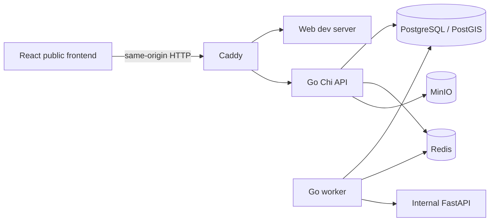

# System overview

`apps/backend` is **one Go module** with separate `cmd/api` and `cmd/worker` executables and shared `internal` code. The worker schedules explicitly registered ingestion adapters; no live external adapter is registered in Phase 3. Go handlers should depend on services, services on repository interfaces only when used, and infrastructure on explicit configuration. Domain concepts must not depend on Chi, HTTP, or vendor types. Python remains internal and separate. React never calls AI, database, Redis, or object storage directly.

The Caddy development proxy sends `/api/*`, `/events/*`, `/docs`, `/openapi.json`, `/health`, and `/ready` to Go and the rest to Vite. `/api/v1/auth/*` and Phase 2 public flood-domain reads/admin writes are implemented; `/events/*` remains reserved. Only localhost web, API, and proxy ports are published in development. Production architecture requires TLS and private internal networks; no production deployment is provided.

The Phase 4 React frontend exposes guest routes for overview, announcements, map shell, CCTV, and reports. Overview reads bounded public flood-event, risk-area, road, and water-station collections, plus the latest reading for at most five listed stations, without authentication. It displays partial failures and freshness/effective statuses rather than treating missing evidence as safe. Announcements, CCTV, and reports remain explicit empty states because no public API exists for them. The map has only presentation controls; spatial layers and routing remain Phase 5.
